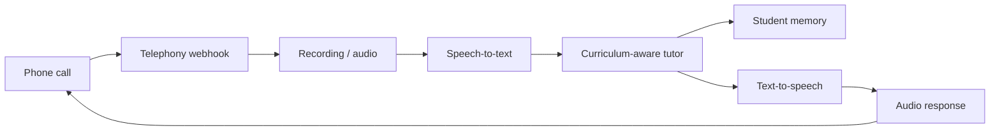

# Education for Equality

Private source for the Education for Equality web platform and Sabi voice-tutoring product.

Sabi is the flagship build: a phone-accessible AI tutor for foundational literacy and numeracy in Nigeria. A learner can call from a shared feature phone without a smartphone, data plan, or reliable internet.

## Public surfaces

- Main site: https://eduforequality.org
- Sabi site/demo: https://sabi.eduforequality.org
- Portfolio case study: https://naomiivie.vercel.app/sabi

## What is in this repo

- Next.js web platform for curriculum, Sabi landing/demo pages, and learner flows.
- Foundational literacy and numeracy lesson content.
- Cambridge-aligned Grade 4 curriculum scaffolding.
- Supabase magic-link authentication and Supabase progress tracking.
- Sabi web voice demo routes.
- Africa's Talking, Twilio, and ElevenLabs voice integration routes.
- RAG utilities for curriculum retrieval.
- Sentry instrumentation for production debugging.

## Sabi voice loop



## Key files

- `app/sabi/page.tsx` - Sabi product page
- `app/sabi-demo/page.tsx` and `app/sabi/demo/page.tsx` - demo surfaces
- `lib/voice/sabi-shared.ts` - core Sabi teaching prompt, curriculum, and memory helpers
- `app/api/sabi/at/*` - Africa's Talking phone webhook routes
- `app/api/sabi/voice/*` - voice/LLM routes
- `docs/elevenlabs-agent-prompt.md` - canonical ElevenLabs ConvAI configuration

## Privacy

This repository should remain private. It contains company/IP-sensitive implementation detail, production integration patterns, and live deployment architecture for Sabi.

## Local development

```bash
npm install
npm run dev
```

Create `.env.local` from `.env.local.example` and use development credentials only.
